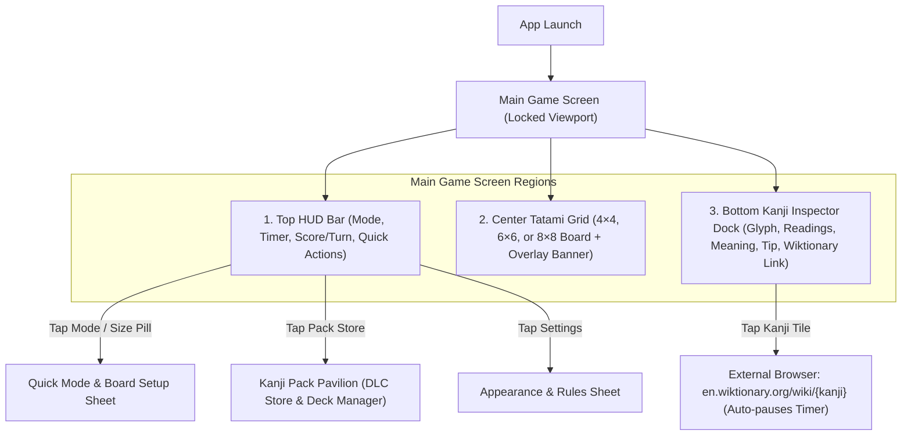
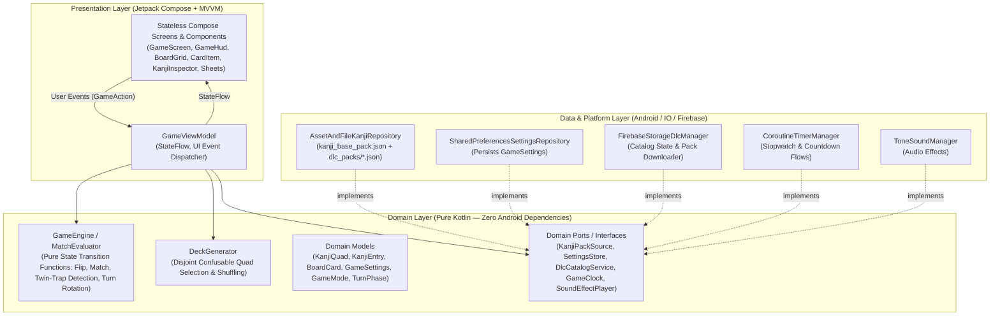
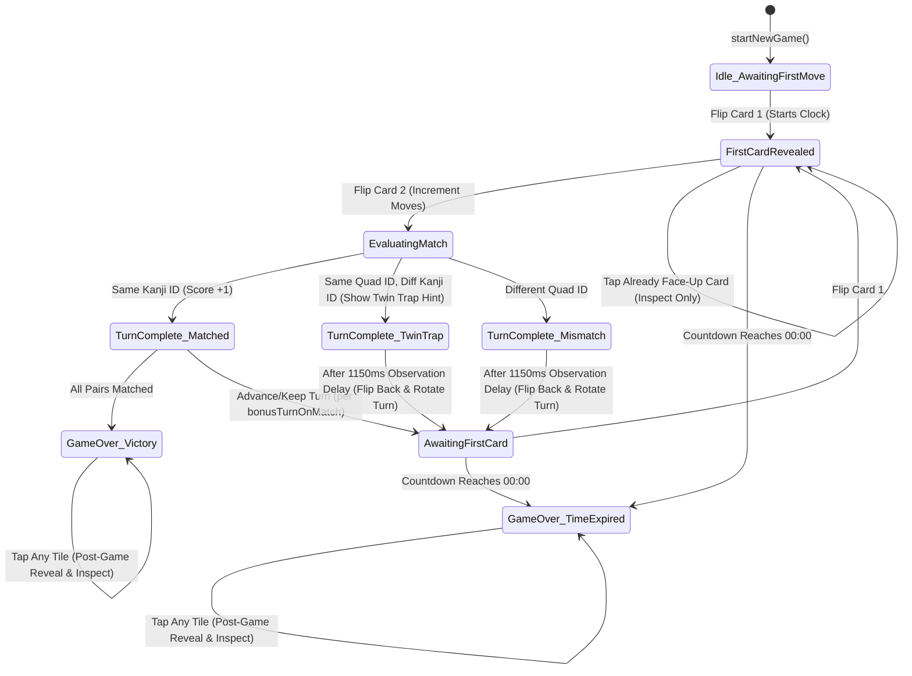

# Kancentration — Ground-Up Game UI/UX Design & Architecture Plan

## 1. Design Vision & Core Pillars

**Kancentration** is a tactical memory and visual-discrimination puzzle game for learners of Japanese. Unlike traditional Concentration—where card faces are distinct icons or numbers—Kancentration populates the board with **Confusable Quads ("Pairs of Pairs")**: two matching pairs of kanji that differ only by a subtle radical, stroke length, hook, or framing proportion (e.g., `日–日` vs `曰–曰`, `木–木` vs `本–本`, `持–持` vs `特–特`, `偉–偉` vs `違–違`).

Our ground-up redesign centers on four UX pillars:

1. **Typography as Gameplay**: When gameplay hinges on spotting whether a stroke pierces a horizontal bar (`牛` vs `午`) or which horizontal line is longer (`末` vs `未`, `土` vs `士`), glyph legibility, stroke contrast, and card fill-ratio are paramount—especially on an `8×8` (64-card) grid.
2. **Tactile "Modern Karuta" Aesthetic**: Inspired by Japanese *Karuta* tiles, *Washi* paper, *Sumi* ink, and *Hanko* vermilion seals. Every card flip, match stamp, and inspector reveal feels physical, calm, and deliberate.
3. **Pedagogical Feedback Loop ("The Confusable Twin Moment")**: Flipping `持` and `特` isn't just a random miss—it's the core learning moment of the game. When a player mismatches two kanji from the *same confusable quad*, the UI surfaces a **"Near-Miss / Kanji Trap!" (`惜しい！`)** micro-feedback and highlights the structural distinction in the inspector below (enabled by default, configurable in Settings).
4. **Zero-Friction Ergonomics & Zero Layout Shift**: All core interactions—flipping tiles, reading definitions/readings in the bottom Kanji Inspector, opening Wiktionary, and checking turn/timer state—happen on a single locked viewport with zero layout shift.

---

## 2. Visual Language & Theme System

### Color Tokens ("Washi & Sumi" Light Theme / "Yoru Ink" Dark Theme)

| Role | Light Mode (Washi Studio) | Dark Mode (Yoru Ink) | Usage |
| :--- | :--- | :--- | :--- |
| **Board / Canvas Background** | `#F6F2EA` (Warm Washi) | `#11161D` (Deep Ink Slate) | Main screen backdrop behind the grid |
| **Surface / Inspector Card** | `#FFFFFF` / `#EFECE6` | `#1B222C` / `#232C3A` | Top HUD bar, bottom Kanji Inspector dock |
| **Primary Accent (P1 / Focus)** | `#1E3A5F` (Aizome Indigo) | `#7AB3EF` (Sky Indigo) | Active card selection border, Player 1 identity |
| **Secondary Accent (P2 / Seal)** | `#C83E2B` (Shu-iro Vermilion) | `#F07167` (Coral Vermilion) | Player 2 identity, Hanko seal accents, Time Attack urgency |
| **Match / Mastery Accent** | `#2A6F4E` (Take-iro Bamboo) | `#52B788` (Jade Green) | Matched card state in Solo mode, completion badges |
| **Gold Foil / Quad Highlight** | `#C99A2E` (Kinpaku Gold) | `#E0B44C` (Bright Gold) | Card-back `漢` crest, "Near-Miss Twin" alert border |
| **Kanji Ink (Card Face)** | `#18181B` (Sumi Charcoal) | `#F4F1EA` (Warm Chalk) | High-contrast kanji rendering on revealed cards |

### Typography & Card Scaling System
- **Glyph Typeface Setting**: High-contrast **Serif / Mincho** default (accentuating *tome*, *hane*, and *harai* stroke endings) with a user-configurable toggle to **Sans-Serif / Gothic** in Settings so learners can compare and practice recognizing kanji in both print styles in situ.
- **Adaptive Grid Density**:
  - `4×4` (16 cards, 4 quads): Generous `8dp` gap, `38sp` glyph, rounded `12dp` corners, subtle inner border frame.
  - `6×6` (36 cards, 9 quads): Medium `5dp` gap, `25sp` glyph, rounded `8dp` corners.
  - `8×8` (64 cards, 16 quads): Crisp `3dp` gap, `17sp` glyph with zero internal card padding overhead so the kanji fills ~75% of the tile height.

---

## 3. Information Architecture & Screen Flows



### Why a Single-Screen-First Architecture with Bottom Sheets?
1. **Immediate Playability**: Players can start flipping cards within 1 second of launching the app, while the **Mode & Board Pill** in the Top HUD lets them switch between `Solo`, `2P Duel`, `Time Attack (1m/3m/5m)`, and `4×4 / 6×6 / 8×8` in two taps.
2. **Preserved Context**: Opening Settings or the DLC Store as modal sheets/dialogs keeps the board visible in the background and automatically pauses the active timer.

---

## 4. Detailed Component & UX Specifications

### A. Top HUD Bar (Compact 2-Tier Header)
- **Top Bar**:
  - **Brand & Active Mode Pill**: Displays `Kancentration` alongside an interactive pill showing the current configuration, e.g., `4×4 • Solo` or `6×6 • ⏳ 3m`. Tapping cycles or opens the quick mode switcher.
  - **Action Cluster**: Clean vector iconography for **DLC Pavilion (Pack Store)**, **Settings**, and **New Game / Restart**.
- **Telemetry Bar**:
  - **Left — Smart Timer Pill**:
    - Starts **only on the first card flip** (so players aren't penalized while orienting themselves).
    - **Solo / 2P**: Counts up (`01:24`) as a calm stopwatch.
    - **Time Attack (1m / 3m / 5m)**: Counts down (`00:42`) with a progress bar tint that shifts from Indigo → Amber (<30s) → Pulsing Vermilion (<10s).
    - **Auto-Pause**: Automatically pauses when the app backgrounds or when the player taps the Kanji Inspector to visit Wiktionary.
  - **Right — Score & Turn Indicator**:
    - **Solo / Time Attack**: Shows `Matches: 5/8` and `Moves: 9`.
    - **2-Player Pass & Play**: Dual player pills (`P1 Indigo` vs `P2 Vermilion`). The active player's pill is elevated with a glowing border, turn indicator dot, and a subtle badge (`+1 Turn on Match` if enabled in settings).

### B. The Game Board & Card States
Each card transitions smoothly through five visual states using a 3D Y-axis rotation (`320ms` cubic-bezier flip):
1. **Face-Down (Unrevealed)**: Customizable tile background (default Warm Ivory or Deep Indigo) with a subtle border frame and a centered `漢` emblem in Kinpaku Gold.
2. **Revealed — 1st Card Selected**: Crisp paper face (`#FAF9F5`), high-contrast Sumi kanji, and a `2dp` **Active Focus Border** (Indigo for P1/Solo, Vermilion for P2).
3. **Evaluating — Match Found!**: Both cards pulse subtly and settle into a **Matched State**—tinted softly with Bamboo Jade (Solo/P1) or Vermilion Rose (P2) and a small corner **Hanko Stamp dot** indicating who claimed the pair.
4. **Evaluating — Standard Mismatch**: Cards remain visible for `1,150ms` so all players can memorize their positions, then flip face-down in place.
5. **Evaluating — "Confusable Twin" Mismatch (`惜しい！`)**:
   - Enabled by default (`showTwinTrapHints = true` in `GameSettings`, configurable in Settings).
   - When the two flipped cards are **different kanji from the same confusable quad** (e.g., `木` and `本`, or `持` and `特`), both cards flash an **Amber/Gold border** with a subtle banner callout (`惜しい！ Confusable Twin: 持 vs 特`) before flipping back down, training the learner's eye to notice the difference immediately.

### C. Bottom Kanji Inspector Dock (The Lexicon Bar)
Directly beneath the game board (occupying ~26% of screen height, fixed so the board never jumps):
- **Empty State (Before First Flip)**: Displays an inviting prompt: *"Tap any tile to begin. Revealed kanji meanings, readings, and visual distinction tips will appear here."*
- **Populated State (Whenever Any Card is Flipped or Tapped)**:
  - **Left: Tappable Kanji Seal Box (`AspectRatio 1:1`)**:
    - Displays the large kanji character (`56sp–64sp`) inside a framed seal box using the active font style (Serif/Mincho or Sans-Serif/Gothic).
    - Includes a clear **`Wiktionary ↗` micro-label** at the bottom of the tile so players immediately know it is interactive.
    - Tapping launches `https://en.wiktionary.org/wiki/<kanji>` via `Intent.ACTION_VIEW` and pauses the game clock.
  - **Right: Structured Lexicon Details**:
    - **Header Row**: Primary English meanings (`hold, have, possess`) + **Stroke Count Badge** (`9画 / 9 strokes`) + **Confusable Twin Tag** (`vs 特`).
    - **Readings Row**: Distinct pill badges for **On'yomi** and **Kun'yomi**.
      - **Default (`showRomaji = false`)**: Displays authentic Kana readings (`ON: ジ` • `KUN: も.つ`).
      - **With Romaji Enabled (`showRomaji = true`)**: Appends Romaji (`ON: ジ (ji)` • `KUN: も.つ (motsu)`).
    - **Distinction Tip Callout**: Highlighted box (`💡 Left radical is 扌 (hand / te-hen) — compare with 牛 (cow) in 特`).
  - **Free Inspection of Face-Up Cards**: Tapping any already-matched or face-up card on the board immediately loads that kanji into the Inspector without costing a move.
  - **Post-Game Board Exploration**: When the game ends (victory or time expired), tapping *any* remaining card on the board reveals it and loads it into the Inspector for study.

### D. Non-Disruptive Victory / Time-Up Banner
- Instead of a blocking popup that hides the board, game completion slides in a **Compact Celebration / Summary Banner** in the dedicated status slot above the board showing:
  - Outcome (`Cleared in 01:18 • 14 Moves!`, `Player 1 Wins (10 – 8)!`, or `Time's Up! 11/18 Pairs Found`).
  - One-tap **`Play Again`** button, while leaving the board and Kanji Inspector fully interactive below.

### E. Settings & Customization Sheet
- **Game Mode Selector**:
  - `1-Player Solo (Stopwatch)`
  - `2-Player Pass & Play`
  - `Time Attack` with segmented duration chips: **`1 Min`**, **`3 Min`**, **`5 Min`**
- **Board Size Selector**: **`4×4 (16)`**, **`6×6 (36)`**, **`8×8 (64)`**
- **Gameplay & Learning Rules**:
  - **Extra Turn on Match** (`Switch`, default **ON**): Controls whether scoring a match grants the active player another turn or passes the turn to the opponent.
  - **Confusable Twin Trap Hints (`惜しい！`)** (`Switch`, default **ON**): Highlights when a mismatch is between two kanji of the same confusable quad.
  - **Show Romaji Readings** (`Switch`, default **OFF**): Toggles Romaji transliterations alongside Kana in the Kanji Inspector.
  - **Kanji Font Style** (`Segmented Toggle`, default **Serif / Mincho**): Switches card and inspector kanji between **Serif (Mincho)** and **Sans-Serif (Gothic)** in situ.
- **Tile Appearance Studio**:
  - Live interactive preview of the card back (`漢`) + curated presets (Aizome Indigo, Washi Ivory, Sumi Black, Bamboo Forest, Urushi Vermilion) and custom Hex color input.
- **Audio**: Sound Effects toggle.

### F. DLC Pack Pavilion (Expansion Store)
- Base game ships with **20 Confusable Quads** (exceeding the 16-quad minimum required for an `8×8` board, including the examples from `DESIGN.MD`: `木 vs 本`, `持 vs 特`, `偉 vs 違`, `日 vs 曰`, plus 16 additional classic confusable pairs).
- **DLC Store Modal**:
  - Displays downloadable expansion packs (*Radical Rivals*, *JLPT N2/N1 Visual Traps*).
  - Shows **Preview Sample Quads** on each pack card (e.g., `社 vs 初`, `崇 vs 祟`) so players can preview the content.
  - Supports download progress indicator and instant integration into `KanjiRepository`.

---

## 5. Software Architecture Plan

To ensure the game is modular, deterministic, and 100% unit-testable on the JVM without Android framework coupling in core logic, the application follows **Clean Architecture** with **Unidirectional Data Flow (UDF)** across three distinct layers: **Presentation (UI)**, **Domain (Game Engine & Contracts)**, and **Data (Repositories & Platform Services)**.

### 5.1 Layered Architecture Diagram



### 5.2 Key Architectural Improvements Over the Prototype

1. **Decoupling `GameViewModel` from `AndroidViewModel`**:
   - *Prototype flaw*: `GameViewModel` extended `AndroidViewModel(application)` and directly instantiated `KanjiRepository(application)`, `SettingsRepository(application)`, `FirebaseStorageDlcManager(application)`, and `SoundManager(application)` inside its constructor, making pure JVM unit testing of `GameViewModel` impossible without Android context mocks.
   - *New Architecture*: `GameViewModel` extends standard `ViewModel` and depends on lightweight interfaces (`KanjiPackRepository`, `SettingsRepositoryContract`, `DlcManagerContract`, `SoundPlayerContract`, `TimerManager`). A `ViewModelProvider.Factory` wires the concrete Android implementations at the `MainActivity` composition root.
2. **Pure Domain Game Engine & Explicit Turn State Machine**:
   - Instead of scattering mutable flags (`firstFlippedCardId`, `secondFlippedCardId`, `isEvaluatingMatch`) across coroutine callbacks, turn progression is modeled as an explicit, deterministic state machine:



3. **Immutable Domain Models & Confusable Twin Lookup**:
   - Each `BoardCard` carries both its `kanji: KanjiData` and its parent `quadId: String` + `confusableTwinCharacter: String` so the UI and `KanjiInspector` can immediately display the confusable twin badge (`vs 特`) and detect near-miss "Twin Traps" in $O(1)$ time without re-scanning the repository.

### 5.3 Package & Module Structure

```text
com.example.kancentration/
├── MainActivity.kt                  # Composition root & ViewModel factory wiring
├── theme/
│   ├── Color.kt                     # Washi & Sumi (Light) / Yoru Ink (Dark) semantic tokens
│   ├── Theme.kt                     # Material3 + custom Kancentration semantic colors
│   └── Type.kt                      # Dynamic Mincho (Serif) & Gothic (Sans) typography helpers
├── data/
│   ├── model/
│   │   ├── KanjiData.kt             # Immutable kanji entry (char, meanings, kana readings, strokeCount, tip, url, twinChar)
│   │   ├── KanjiQuad.kt             # Confusable pair of pairs (id, category, pairA, pairB)
│   │   ├── BoardCard.kt             # Instance state on the grid (instanceId, kanji, quadId, isFaceUp, isMatched, matchedByPlayer, isTwinTrapHighlight)
│   │   ├── GameMode.kt              # BoardDimension (4x4, 6x6, 8x8), GameType (Solo, TwoPlayer, TimeAttack), GameSettings
│   │   └── DlcPackManifest.kt       # DLC catalog item (including sampleQuadPreview) & download states
│   ├── repository/
│   │   ├── KanjiRepository.kt       # Loads assets/kanji_base_pack.json + filesDir/dlc_packs/*.json; disjoint deck generator
│   │   └── SettingsRepository.kt    # Persists GameSettings (including showTwinTrapHints, showRomaji, useSerifFont)
│   └── firebase/
│       └── FirebaseStorageDlcManager.kt # Manages DLC pack catalog, previews, and local installation
├── domain/
│   ├── GameEngine.kt                # Pure Kotlin match/mismatch/twin-trap evaluator & turn rules
│   ├── TimerManager.kt              # Pause-aware Coroutine stopwatch & countdown clock
│   └── SoundManager.kt              # Audio synthesis/playback for flip, match, twin-trap, mismatch, tick, victory
└── ui/
    ├── viewmodel/
    │   ├── GameUiState.kt           # Single immutable source of truth for the entire GameScreen
    │   └── GameViewModel.kt         # Coordinates GameEngine, TimerManager, Repositories, and UI intents
    └── components/
        ├── GameScreen.kt            # Locked-viewport scaffold (HUD + Status Slot + Board Stage + Inspector Dock)
        ├── GameHud.kt               # 2-tier compact header (Mode/Dimension switcher, Timer pill, P1/P2 score pills)
        ├── StatusBannerSlot.kt      # Fixed-height slot for Twin-Trap alerts ("惜しい！"), turn hints, and Victory/Time-Up banner
        ├── BoardGrid.kt             # Responsive square grid computing exact tile geometry for 4x4, 6x6, 8x8
        ├── CardItem.kt              # 3D Y-axis flip card with Karuta back, Hanko match stamp, and Twin-Trap amber ring
        ├── KanjiInspector.kt        # Scholar's Lexicon dock with Wiktionary seal tile, Kana/Romaji pills, and distinction tip
        ├── SettingsDialog.kt        # Setup & Customization sheet (Mode, Size, Typography, Twin-Trap, Romaji, Tile Studio)
        └── DlcStoreDialog.kt        # Kanji Pack Pavilion with quad previews and download progress
```

### 5.4 Data & State Contracts

#### `GameSettings` Contract
```kotlin
data class GameSettings(
    val dimension: BoardDimension = BoardDimension.FOUR_BY_FOUR,
    val gameType: GameType = GameType.Solo,
    val bonusTurnOnMatch: Boolean = true,
    val showTwinTrapHints: Boolean = true,   // Decision 1: ON by default, settable
    val showRomaji: Boolean = false,         // Decision 2: OFF by default, settable
    val useSerifFont: Boolean = true,        // Decision 3: Mincho (Serif) by default, toggleable to Gothic (Sans)
    val soundEnabled: Boolean = true,
    val tileColor: Long = 0xFF1E3A5FL,       // Default Aizome Indigo
    val kanjiColor: Long = 0xFFE0B44CL       // Default Kinpaku Gold
)
```

#### `GameUiState` Contract
```kotlin
data class GameUiState(
    val cards: List<BoardCard> = emptyList(),
    val firstFlippedCardId: String? = null,
    val secondFlippedCardId: String? = null,
    val isEvaluatingMatch: Boolean = false,
    val activeTwinTrapBanner: String? = null, // e.g., "持 vs 特 (Radical Nuance)" when Twin Trap occurs
    val activePlayer: Int = 1,
    val player1Score: Int = 0,
    val player2Score: Int = 0,
    val totalMoves: Int = 0,
    val totalMatches: Int = 0,
    val selectedKanjiForInspector: KanjiData? = null,
    val settings: GameSettings = GameSettings(),
    val isGameOver: Boolean = false,
    val isTimeExpired: Boolean = false,
    val gameOverMessage: String = "",
    val formattedTimer: String = "00:00",
    val isTimerLowWarning: Boolean = false,   // True in Time Attack when < 15s remain
    val showSettingsDialog: Boolean = false,
    val showDlcStoreDialog: Boolean = false
)
```

### 5.5 Concurrency, Lifecycle & Edge-Case Handling
- **Lazy Clock Start**: `TimerManager` is armed on `startNewGame()`, but only starts ticking when the first face-down card is flipped.
- **Lifecycle & External Intent Pause**:
  - Navigating to Wiktionary (`onOpenWiktionary()`) or backgrounding the app (`ON_PAUSE`) pauses the active stopwatch/countdown.
  - Returning (`ON_RESUME`) resumes the clock only if a game is actively in progress and no modal sheet (Settings / DLC Store) is open.
- **Race-Condition Prevention**:
  - While `isEvaluatingMatch == true` (the `500ms` match confirmation or `1,150ms` mismatch observation window), additional card-flip taps are ignored for turn evaluation, while still allowing players to tap already-matched cards to inspect them.
  - Starting a new game or changing board dimensions immediately cancels any in-flight match-evaluation coroutine `Job` so stale flips never mutate a fresh board.

### 5.6 Testing & Verification Strategy
- **Unit Tests (`src/test/`)**:
  - `GameEngineTest`: Verifies match scoring, 2-player turn rotation with `bonusTurnOnMatch` ON vs OFF, Confusable Twin-Trap detection (`same quadId, different kanji.id`), and victory/time-up conditions.
  - `KanjiDeckTest`: Verifies deck sizes (`16`, `36`, `64`), quad integrity (every selected quad contributes 2× PairA and 2× PairB), and zero duplicate kanji across quads.
  - `SettingsRepositoryTest`: Verifies persistence and defaults for all settings including `showTwinTrapHints` (`true`), `showRomaji` (`false`), and `useSerifFont` (`true`).
  - `KanaConverterTest`: Verifies accurate Kana-to-Romaji conversion when the Romaji setting is enabled.
- **UI & Integration Tests (`src/androidTest/`)**:
  - Verifies board rendering across `4×4`, `6×6`, and `8×8`, Kanji Inspector updates on tile click, and Settings toggles.

---

## 6. Implementation Sequence

1. **Data & Content Layer (`kanji_base_pack.json`, `GameMode.kt`, `KanjiData.kt`, `SettingsRepository.kt`, `KanjiRepository.kt`)**:
   - Curate `kanji_base_pack.json` with 20 Confusable Quads including the `DESIGN.MD` signature examples (`木 vs 本`, `持 vs 特`, `偉 vs 違`, `日 vs 曰`).
   - Add `twinCharacter` metadata to `KanjiData` and the three new settings (`showTwinTrapHints`, `showRomaji`, `useSerifFont`) to `GameSettings` and `SettingsRepository`.
2. **Domain & ViewModel Layer (`GameEngine.kt`, `GameUiState.kt`, `GameViewModel.kt`)**:
   - Implement `GameEngine` and update `GameViewModel` with cancellable match-evaluation jobs, Twin-Trap detection, and dependency injection support.
3. **Theme & Typography (`theme/`)**:
   - Implement the **Washi & Sumi** light theme and **Yoru Ink** dark theme tokens plus the Mincho/Gothic font switcher.
4. **UI Components (`ui/components/`)**:
   - Build the redesigned `GameHud`, `StatusBannerSlot` / `GameOverBanner`, `BoardGrid`, `CardItem`, `KanjiInspector`, `SettingsDialog`, and `DlcStoreDialog`.
5. **Unit & Instrumentation Tests**:
   - Add and run unit tests for `GameEngine`, `KanjiRepository`, `SettingsRepository`, and `KanaConverter`.
